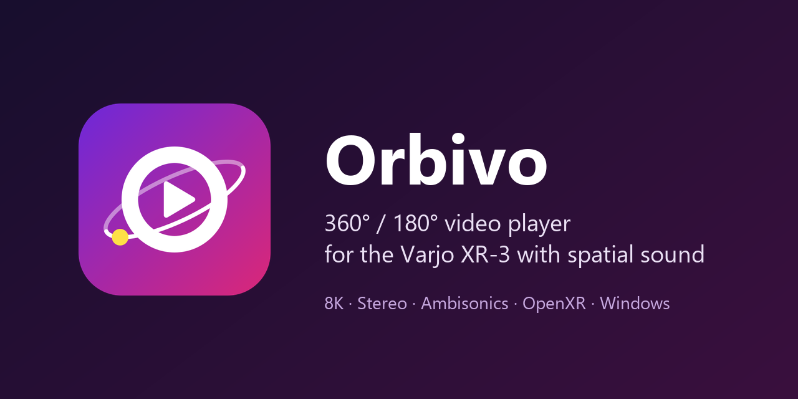

# Orbivo

[](https://github.com/QuenCode/Orbivo/actions/workflows/ci.yml)

*English: [README.md](README.md)*



Orbivo ist ein Windows-Player für 360°- und 180°-Videos (bis 8K, Mono und Stereo, räumlicher Ton) auf einer
**Varjo XR-3**. Gedacht ist er für betreute Vorführungen: Ein **Operator** steuert alles am Desktop, die Person
mit Brille schaut nur zu und sieht nie eine Bedienoberfläche.

## Funktionen

- **Video** bis 8K mit Hardware-Dekodierung (D3D11VA): H.264, HEVC, AV1, VP9, 8 und 10 Bit
- **Projektionen:** Equirect 360° und 180° (VR180), Cubemap, Equi-Angular Cubemap (EAC), Fisheye;
  **Stereo** Top-Bottom und Side-by-Side. Erkannt aus den Spherical-Video-Metadaten oder pro Video eingestellt
  (gespeichert neben dem Video als `<Video>.orbivo.json`)
- **Räumlicher Ton, berechnet im Player** für normale kabelgebundene Kopfhörer (Steam Audio):
  Stereo von zwei virtuellen Lautsprechern im Video, Ambisonics 1. bis 3. Ordnung (AmbiX, FuMa); der Ton bleibt
  beim Kopfdrehen am Bild
- **Operatorfenster:** Playlist, Zeitleiste, Tastenkürzel, Schwarzbild, Fade, Recenter, Live-Ansicht dessen, was die
  Brille zeigt, und Statusanzeige (Brille, Bildrate, Decoder, A/V-Synchronität)
- **Leerlauf-Ansicht** in der Brille, wenn kein Video läuft: Schwarz, Kamerabild oder Standbild
- **Aufzeichnung** von Kopfbewegung und Bedienereignissen als CSV, wahlweise ein Dateipaar je Video
- Operatorfenster und Anleitung auf **Deutsch und Englisch**
- Keine Installation, kein Netzwerkzugriff, keine Telemetrie: ZIP entpacken und `Orbivo.exe` starten

## Voraussetzungen

- Windows 10 oder 11, 64 Bit
- **Varjo XR-3** mit laufendem [Varjo Base](https://varjo.com/) (OpenXR-Runtime). Orbivo spricht die Brille nur über
  OpenXR an; andere Brillen sind ungetestet
- NVIDIA-RTX-Grafikkarte empfohlen (Zielsysteme: RTX 5080 Desktop, RTX 4080 Laptop); 8K braucht
  Hardware-Dekodierung für HEVC/AV1
- Kabelgebundene Stereo-Kopfhörer ohne eigene Raumklang-Verarbeitung

Ohne Brille zeigt `Orbivo.exe --no-xr` das Bild in einem Desktop-Fenster.

## Herunterladen und starten

1. `Orbivo-<Version>-win-x64.zip` unter [Releases](https://github.com/QuenCode/Orbivo/releases) herunterladen.
2. In einen beschreibbaren Ordner entpacken (nicht unter `C:\Programme`).
3. Varjo Base starten, dann `Orbivo.exe`. **F1** öffnet die Anleitung
   ([Deutsch](docs/Anleitung.html), [English](docs/Manual.html)).

## Aus dem Quellcode bauen

Benötigt das [.NET 10 SDK](https://dotnet.microsoft.com/download) und Windows PowerShell.

```powershell
# Native Bibliotheken (FFmpeg, Steam Audio, OpenXR-Loader) mit gepinnten Prüfsummen, siehe native/README.md
powershell -NoProfile -ExecutionPolicy Bypass -File native\fetch-native.ps1

dotnet build Orbivo.sln -c Debug
dotnet test
dotnet run --project src/Orbivo.App -- --no-xr
```

Testbilder, Testvideos und ein Ambisonics-Test entstehen mit `python tools/testmedia/make_testmedia.py`
(siehe [tools/testmedia/README.md](tools/testmedia/README.md)). Tests, die diese Dateien, eine GPU oder ein
Audiogerät brauchen, überspringen sich selbst, wenn etwas fehlt.

Die technische Dokumentation ist englisch: [Anforderungen](docs/SPEC.md), [Architektur](docs/ARCHITECTURE.md),
[Entscheidungen](docs/DECISIONS.md), [Meilensteine](docs/ROADMAP.md), [Releases](docs/RELEASE.md).

## Stand

Orbivo ist ein kleines Projekt, gepflegt in der Freizeit, und wird mit einem Brillentyp genutzt, der Varjo XR-3.
Fehlermeldungen und Pull Requests sind willkommen, siehe [CONTRIBUTING.md](CONTRIBUTING.md).
Sicherheitslücken: [SECURITY.md](SECURITY.md).

## Entstehung

Der Großteil des Quellcodes wurde mit [Claude Code](https://claude.com/claude-code) (Anthropic) geschrieben. Der
Projektinhaber hat die Anforderungen geschrieben, die Entscheidungen getroffen, die Ergebnisse geprüft und alles mit
der Brille getestet. Die Arbeitsregeln für die KI stehen in [CLAUDE.md](CLAUDE.md), der erste Prompt in
[docs/START-PROMPT.md](docs/START-PROMPT.md) (übersetzt), jede Entscheidung mit Begründung in
[docs/DECISIONS.md](docs/DECISIONS.md). Commits, an denen die KI mitgeschrieben hat, tragen eine Zeile
`Co-Authored-By: Claude`. Auch das App-Icon ist mit Claude entstanden.

## Lizenz

Orbivo steht unter der [Apache License 2.0](LICENSE), Copyright 2026 QuenCode (siehe [NOTICE](NOTICE)).

Das Release-Paket enthält Komponenten anderer Hersteller unter deren eigenen Lizenzen
([build/THIRD-PARTY-NOTICES.txt](build/THIRD-PARTY-NOTICES.txt)):

- **FFmpeg** 9.0.2 mit dav1d und zlib, LGPL-2.1-or-later. Orbivo nutzt Bibliotheken des FFmpeg-Projekts unter der
  LGPL, in einem eigenen, schlanken Build ([build/ffmpeg](build/ffmpeg/README.md)), dessen vollständiger Quellcode
  jedem Release beiliegt
- **Steam Audio** (Valve), Apache License 2.0
- **OpenXR-Loader** (Khronos), Apache License 2.0
- **.NET**, CommunityToolkit.Mvvm, NAudio, Silk.NET, Vortice.Windows, FFmpeg.AutoGen: MIT License

Orbivo ist ein unabhängiges Projekt und steht in keiner Verbindung zu Varjo, Valve, NVIDIA, Microsoft oder dem
FFmpeg-Projekt. Varjo, Steam, NVIDIA, Windows und FFmpeg sind Marken ihrer jeweiligen Inhaber.

## Zitieren

Wer Orbivo in der Forschung nutzt, zitiert es bitte wie in [CITATION.cff](CITATION.cff) angegeben
(GitHub zeigt das unter „Cite this repository“).
