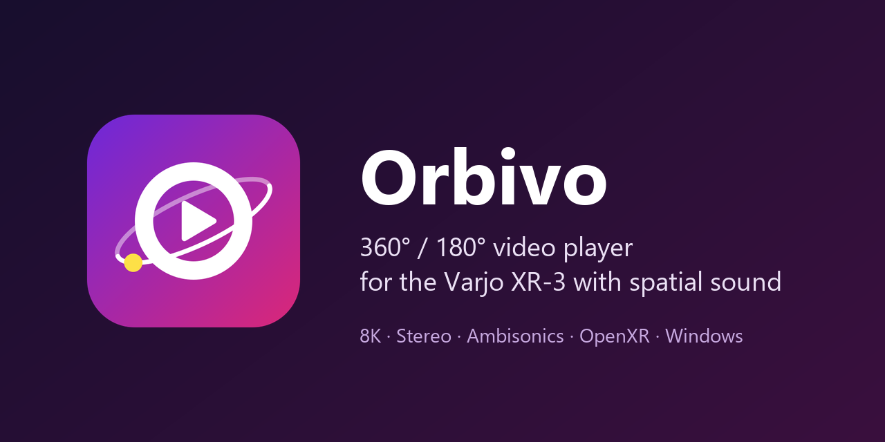

# Orbivo

[](https://github.com/QuenCode/Orbivo/actions/workflows/ci.yml)

*Deutsch: [README.de.md](README.de.md)*



Orbivo is a Windows player for 360° and 180° videos (up to 8K, mono and stereo, spatial sound) on a **Varjo XR-3**.
It is made for controlled viewing sessions: an **operator** controls everything from the desktop, the person wearing
the headset only watches and never sees any user interface.

## Features

- **Video** up to 8K with hardware decoding (D3D11VA): H.264, HEVC, AV1, VP9, 8 and 10 bit
- **Projections:** equirectangular 360° and 180° (VR180), cubemap, equi-angular cubemap (EAC), fisheye;
  **stereo** top-bottom and side-by-side. Detected from the spherical video metadata or set per video
  (saved next to the video as `<video>.orbivo.json`)
- **Spatial sound computed in the player** for plain wired headphones (Steam Audio):
  stereo from two virtual speakers in the video, Ambisonics of order 1 to 3 (AmbiX, FuMa); the sound stays with the
  picture when the head turns
- **Operator window:** playlist, timeline, keyboard shortcuts, blackout, fade, recenter, a live view of what the
  headset shows, and a status panel (headset, frame rate, decoder, A/V sync)
- **Idle view** in the headset when no video runs: black, camera passthrough or a still image
- **Recording** of head movement and operator events as CSV, optionally one pair of files per video
- Operator window and manual in **English and German**
- No installation, no network access, no telemetry: unpack the ZIP and start `Orbivo.exe`

## Requirements

- Windows 10 or 11, 64 bit
- **Varjo XR-3** with [Varjo Base](https://varjo.com/) running (OpenXR runtime). Orbivo talks to the headset through
  OpenXR only; other headsets are untested
- NVIDIA RTX graphics card recommended (target systems: RTX 5080 desktop, RTX 4080 laptop); 8K needs hardware
  HEVC/AV1 decoding
- Wired stereo headphones without their own spatial processing

Without a headset, `Orbivo.exe --no-xr` shows the picture in a desktop window.

## Download and start

1. Download `Orbivo-<version>-win-x64.zip` from [Releases](https://github.com/QuenCode/Orbivo/releases).
2. Unpack it to a writable folder (not under `C:\Program Files`).
3. Start Varjo Base, then `Orbivo.exe`. **F1** opens the manual
   ([English](docs/Manual.html), [Deutsch](docs/Anleitung.html)).

## Building from source

Needs the [.NET 10 SDK](https://dotnet.microsoft.com/download) and Windows PowerShell.

```powershell
# Native libraries (FFmpeg, Steam Audio, OpenXR loader) with pinned checksums, see native/README.md
powershell -NoProfile -ExecutionPolicy Bypass -File native\fetch-native.ps1

dotnet build Orbivo.sln -c Debug
dotnet test
dotnet run --project src/Orbivo.App -- --no-xr
```

Test images, videos and an Ambisonics test come from `python tools/testmedia/make_testmedia.py`
(see [tools/testmedia/README.md](tools/testmedia/README.md)). Tests that need them, a GPU or a sound device skip
themselves when these are missing.

| Folder | Content |
|---|---|
| `src/Orbivo.App` | WPF operator window |
| `src/Orbivo.Core` | formats, projection math, playlist, recording, settings |
| `src/Orbivo.Media` | FFmpeg demuxing and decoding |
| `src/Orbivo.Audio` | sound output (WASAPI) and spatial sound (Steam Audio) |
| `src/Orbivo.Xr` | OpenXR and Direct3D 11 rendering |
| `build/ffmpeg` | the lean FFmpeg build that Orbivo ships |
| `docs` | requirements, architecture, decisions, roadmap, release process, manuals |

## Status

Orbivo is a small project maintained in spare time. It is used with a single headset type, the Varjo XR-3.
Bug reports and pull requests are welcome, see [CONTRIBUTING.md](CONTRIBUTING.md).
Security issues: [SECURITY.md](SECURITY.md).

## How Orbivo was built

Most of the source code was written with [Claude Code](https://claude.com/claude-code) (Anthropic). The project
owner wrote the requirements, made the design decisions, reviewed the results and tested everything with the
headset. The working rules for the AI are in [CLAUDE.md](CLAUDE.md), the first prompt in
[docs/START-PROMPT.md](docs/START-PROMPT.md), and every decision with its reason in
[docs/DECISIONS.md](docs/DECISIONS.md). Commits written with the AI carry a `Co-Authored-By: Claude` line.
The app icon was made with Claude as well.

## License

Orbivo is licensed under the [Apache License 2.0](LICENSE), copyright 2026 QuenCode (see [NOTICE](NOTICE)).

The release package contains third-party components under their own licenses
([build/THIRD-PARTY-NOTICES.txt](build/THIRD-PARTY-NOTICES.txt)):

- **FFmpeg** 9.0.2 with dav1d and zlib, LGPL-2.1-or-later. Orbivo uses libraries of the FFmpeg project under the
  LGPL; it is a lean build of its own ([build/ffmpeg](build/ffmpeg/README.md)) whose complete source code is attached
  to every release
- **Steam Audio** (Valve), Apache License 2.0
- **OpenXR loader** (Khronos), Apache License 2.0
- **.NET**, CommunityToolkit.Mvvm, NAudio, Silk.NET, Vortice.Windows, FFmpeg.AutoGen: MIT License

Orbivo is an independent project and is not affiliated with or endorsed by Varjo, Valve, NVIDIA, Microsoft or the
FFmpeg project. Varjo, Steam, NVIDIA, Windows and FFmpeg are trademarks of their respective owners.

## Citing

If you use Orbivo in research, please cite it as described in [CITATION.cff](CITATION.cff)
(GitHub shows it under "Cite this repository").
